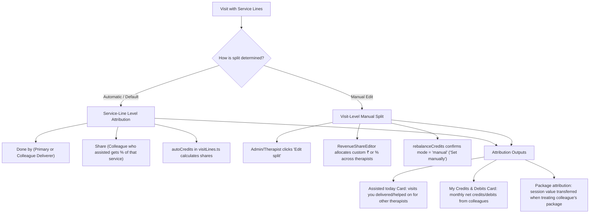

# Workspace UX Refinements & Therapist/Admin Scoping Plan

**Status (2026-11-08):** Tasks 1 to 6 and the Task 7 addition are built and committed (`871dec6`, `cd00e0a`, `6b7f6be`, `4a01692`). Since then, also built: a global Place filter beside All | Mine, and a front-desk collected-by-method line. The checkboxes below were not ticked as work landed. Waiting on the owner's browser check, then delete this file.

> **For agentic workers:** REQUIRED SUB-SKILL: Use superpowers:subagent-driven-development (recommended) or superpowers:executing-plans to implement this plan task-by-task. Steps use checkbox (`- [ ]`) syntax for tracking.

**Goal:** Elevate Workspace daily usability by adding role-aware "Mine vs All" filtering for Today's Visits and Appointments, harmonizing attribution and credits visibility for treating clinicians (including clinic owner-therapists), standardizing Follow-up Reviews formatting and segmented controls, and polishing empty states.

**Architecture:** Pure client-side reactivity leveraging existing Dexie repositories (`dashboardService.todayWorklist`, `repos.appointments`), TanStack Router, and `useWorkspaceScope`. Attribution maths remain strictly in `src/domain/visitLines.ts` (`autoCredits`) and `src/domain/payBase.ts`. UI components adhere strictly to CSS variables and TheraNet design tokens.

**Tech Stack:** React, TypeScript, TanStack Router, Dexie.js (IndexedDB), Tailwind CSS with custom CSS variables.

---

## Global Constraints
- No new npm dependencies.
- CSS variables only (`var(--teal)`, `var(--teal-strong)`, `var(--ink)`, `var(--border)`, `var(--paper)`, `var(--surface)`, `var(--muted)`).
- Vocabulary is fixed: "Done by" and "Share"; never "helper", "assistant" or "co-therapist" as UI labels. A manually edited split reads "Set manually".
- Dense table rows must use clean, lightweight text links (`text-[var(--teal)] hover:underline`); never turn repeated table cells into full pill buttons.
- Fast tests with `npm run check:fast` during development.

---

## Part 1: How Attribution & Splits Work in TheraNet

TheraNet operates on two distinct revenue-split layers:



### The Attribution Visibility Gap:
1. **Treating Admins are Blind to Their Own Credits:** Currently, line 1232 of `WorkspacePage.tsx` gates `MyCreditsCard` with `!scope.isClinicWideView && scope.myTherapistId`. In private practices where the clinic owner/admin also actively treats patients, the admin is treated as `isClinicWideView = true`, meaning they cannot see their own credits/debits card on the Workspace.
2. **Daily Personal Cut:** A therapist sees their primary visits under "Today's visits" and co-treatments under "Assisted today", but there is no quick tally of their personal daily earnings without opening Reports.

---

## Part 2: Task Breakdown

### Task 1: Follow-Up Reviews Row & Subtitle Polish

**Files:**
- Modify: `src/features/followUp/ReviewsPanel.tsx`
- Modify: `src/features/followUp/ReviewsPanel.test.tsx`

**Description:**
Standardize review row formatting to match TheraNet's canonical date and metadata standards. Replace hyphenated numeric date (`due in 3 days - 11/11/26`) with `Due in 3 days · 11 Nov` (`formatDateDM`). Include patient ID (`mrno`) beside patient name. Keep `Dismiss` as quiet text (`text-[var(--muted)] hover:text-[var(--rust)]`) so it does not compete with primary actions.

- [ ] **Step 1: Write test for review row date and patient ID formatting**
  Verify that `ReviewsPanel` formats dates using `formatDateDM` with middle dot `·` and shows the patient's ID when available.
- [ ] **Step 2: Update ReviewRow in `ReviewsPanel.tsx`**
  - Use `formatDateDM` for due date.
  - Render patient ID (`mrno`) in `font-num text-xs text-[var(--muted)]`.
  - Keep `Dismiss` button quiet as-is.
- [ ] **Step 3: Run Vitest and verify**
  Run `npx vitest run src/features/followUp/ReviewsPanel.test.tsx`.

---

### Task 2: Follow-Up Level 1 Segmented Tab Switcher

**Files:**
- Modify: `src/features/workspace/WorkspacePage.tsx`

**Description:**
Replace the raw Level 1 pill buttons `[Reviews (N)] [Packages (M)]` with a clean **Segmented Tab Control** (`bg-[var(--paper)] p-0.5 rounded-lg`). This visually differentiates Level 1 mode switching from Level 2 filter chips (`Due`, `Missed`, `No-shows`), eliminating the "pills stacked on pills" visual clutter.

- [ ] **Step 1: Implement Segmented Control for `followTab`**
  Style the `Reviews` / `Packages` switch as a contiguous segmented container where the active tab has `bg-[var(--surface)] text-[var(--ink)] shadow-2xs font-semibold rounded-md px-3 py-1 text-xs`, and inactive has `text-[var(--muted)] hover:text-[var(--ink)]`.
- [ ] **Step 2: Keep Level 2 filters as filter chips**
  `ReviewsPanel` filter chips (`Due`, `Missed`, `No-shows`) and Packages filter chips (`Open`, `Needs attention`) remain crisp, independent chips.
- [ ] **Step 3: Verify in browser and check responsiveness**

---

### Task 3: Today's Visits Role-Aware "Mine vs All" Filter

**Files:**
- Modify: `src/features/workspace/WorkspacePage.tsx`
- Modify: `src/features/workspace/WorkspacePage.test.tsx` (or new test file)

**Description:**
Provide an instant "Mine only" toggle for Today's visits:
- Pure treating therapist: Defaults to **"Mine only"**, with a toggle to view **"All clinic"**.
- Front desk / non-treating admin: Defaults to **"All clinic"** (no toggle needed if not linked to a therapist).
- Admin who is also a treating therapist (`isAdmin && myTherapistId`): Defaults to **"All clinic"**, with a one-tap toggle to filter to **"Mine only"**.

- [ ] **Step 1: Add `visitsScope` state in `WorkspacePage.tsx`**
  ```tsx
  // Default to 'mine' for pure therapists, 'all' for admin/front_desk
  const [visitsMineOnly, setVisitsMineOnly] = useState<boolean>(() => !scope.isClinicWideView && Boolean(scope.myTherapistId));
  ```
- [ ] **Step 2: Filter today's visit rows based on `visitsMineOnly`**
  When `visitsMineOnly` is true, filter `today.visits` where `row.therapistId === scope.myTherapistId`.
- [ ] **Step 3: Add `[ All | Mine ]` toggle in Today's Visits SectionCard header**
  Display beside the `Columns ▾` picker when the user has a `scope.myTherapistId`.
- [ ] **Step 4: Run Vitest tests to ensure no regressions**

---

### Task 4: Appointments "Mine vs All" Scoping for Treating Admins & Therapists

**Files:**
- Modify: `src/features/workspace/WorkspacePage.tsx`

**Description:**
Currently, Appointments strictly uses `scope.scopeTherapistId`, locking treating admins into "All" and pure therapists into "Mine".
- Add an `[ All | Mine ]` toggle to Appointments when the user has a linked therapist ID (`scope.myTherapistId`).
- Treating admins can toggle from the 50-patient clinic queue to "Just my appointments" with 1 tap.
- Therapists can check if a colleague is free for a handover by toggling to "All".

- [ ] **Step 1: Wire `appointmentsMineOnly` state**
  Default to `!scope.isClinicWideView` (true for therapist, false for admin).
- [ ] **Step 2: Filter `workspaceAppointments` based on `appointmentsMineOnly`**
- [ ] **Step 3: Add toggle in Appointments card header beside `+ Awaiting` / `Open schedule`**

---

### Task 5: Move My Credits & Debits from Workspace to Ledger

**Files:**
- Modify: `src/features/workspace/WorkspacePage.tsx`
- Modify: `src/features/visits/LedgerPage.tsx`
- Modify: `src/features/visits/LedgerTabs.test.ts`

**Description:**
Remove `MyCreditsCard` from `WorkspacePage.tsx` so the Workspace is 100% focused on today's real-time patient queue (`Assisted today` remains for today's co-treatments).
Move the multi-month credits & debits view into `LedgerPage.tsx` as a dedicated tab (`Credits` / `My Credits`), visible when therapist revenue sharing is enabled.

- [ ] **Step 1: Write test for `filterLedgerTabs` with `canViewCredits` in `LedgerTabs.test.ts`**
- [ ] **Step 2: Update `LEDGER_TAB_ITEMS` and `filterLedgerTabs` in `LedgerPage.tsx`**
  Add `'credits'` to `RecordsView` and `LEDGER_TAB_ITEMS`. When `canViewCredits` is true, include the `credits` tab.
- [ ] **Step 3: Render `MyCreditsCard` inside `LedgerPage.tsx` when `recordsView === 'credits'`**
- [ ] **Step 4: Remove `MyCreditsCard` from `WorkspacePage.tsx`**
- [ ] **Step 5: Run `LedgerTabs.test.ts` and verify passing tests**

---

### Task 6: Appointments & Visits Empty-State Polish

**Files:**
- Modify: `src/features/workspace/WorkspacePage.tsx`
- Modify: `src/components/schedule/TodayAppointments.tsx`

**Description:**
Eliminate verbatim repetition between the header badge and empty body text.
- In `TodayAppointments`: When `appointments.length === 0`, instead of repeating *"No appointments today"*, display:
  *"No appointments scheduled for today. Book a slot or check tomorrow's schedule."* with a direct link to tomorrow on the Schedule grid.
- Keep the card compact and friendly.

- [ ] **Step 1: Polish empty state microcopy and action link in `TodayAppointments.tsx`**
- [ ] **Step 2: Run Vitest suite `TodayAppointments.test.tsx` and verify passing tests**

---

## Verification & Execution Order
1. Run `npm run check:fast` after each task.
2. Run targeted Vitest test suites:
   `npx vitest run src/components/schedule/TodayAppointments.test.tsx src/features/followUp/ReviewsPanel.test.tsx`
3. Check ESLint:
   `npx eslint src/features/workspace/WorkspacePage.tsx src/features/followUp/ReviewsPanel.tsx`


---

### Task 7 (built by Claude, 2026-11-08): Where the All | Mine toggle lives, therapist filter and totals

Replaces the header toggle in Tasks 3 and 4. Built in the working tree on top of this plan's edits; see `workspaceView.ts`, `WorkspaceViewToggle.tsx`, `TodayVisitsExtras.tsx`, `todayTotals.ts` (all tested) and `FEATURES_AND_SCHEMA.md` ("Today-First Workspace").
- The toggle sits under the Collected / Dues tiles and says those tiles do not follow it.
- The view is derived each render from the role (therapist opens on Mine, admin and front desk on All, an unlinked therapist sees nothing); no initial-value state.
- Follow up (Reviews and Packages) and Packages follow the same view.
- Today's visits gets a Therapist select (when the view is All and 2+ therapists have visits) and a totals row of visits, billed, paid and due over every visit in view.
- A therapist on All sees colleagues' bill amounts.
